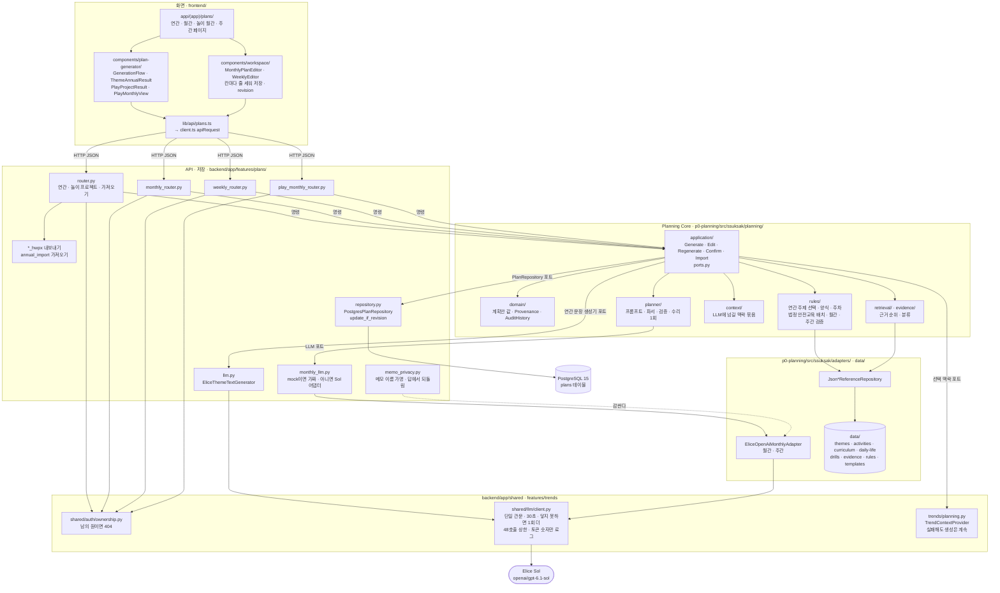
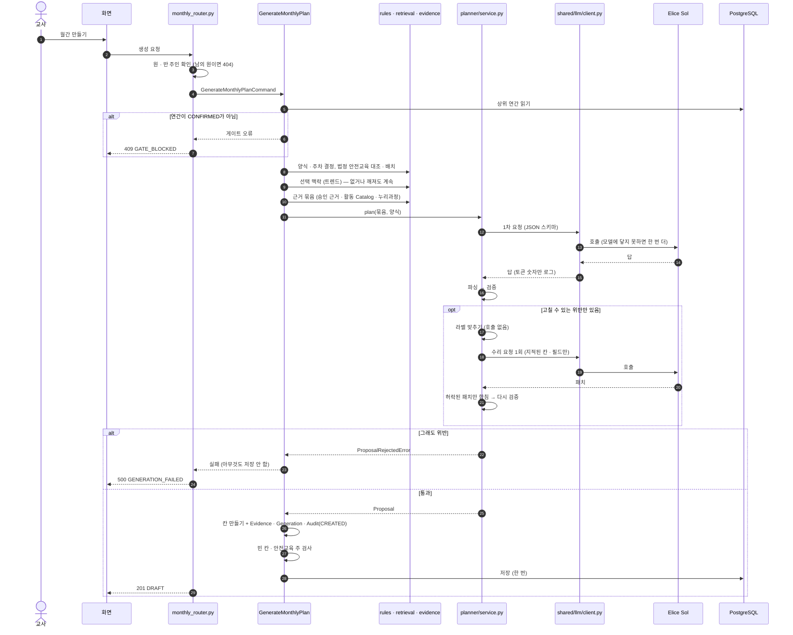
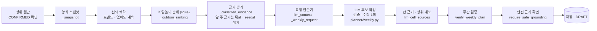
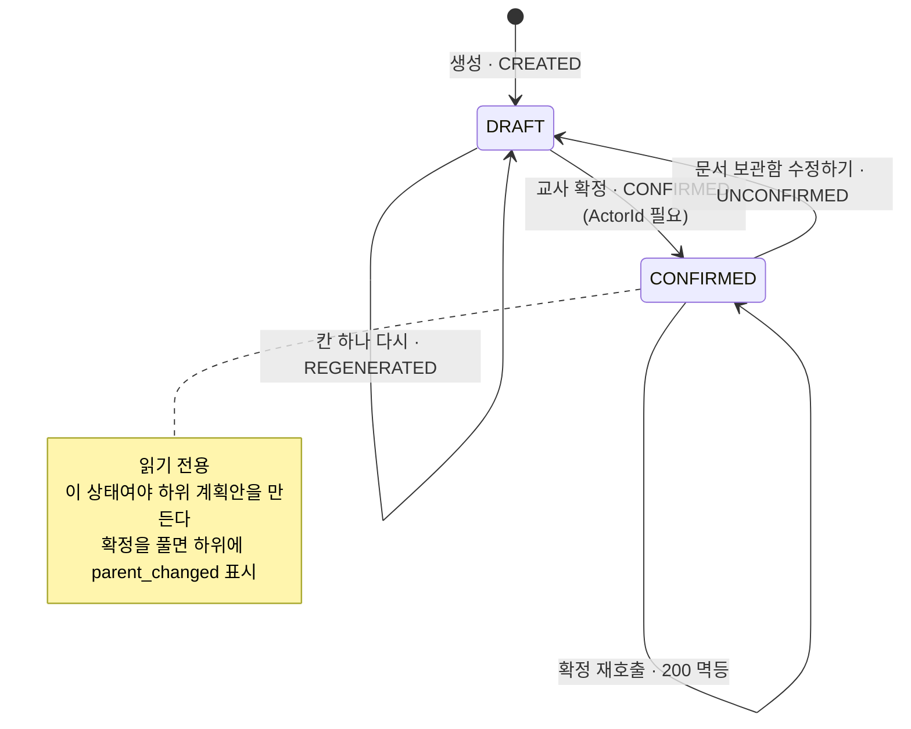

# 코드 구조 — 계획안

[테크스펙 요약](README.md)의 계획안 기능이 코드에서 어느 층을 지나는지, 어떤 기술을 어디에 어떻게 썼는지 적는다.
경로는 develop 기준이다.

## 1. 층

```
화면       frontend/                          Next 16 · React 19 · TypeScript 5
  ↓ HTTP JSON — lib/api/client.ts apiRequest 한 곳으로 부른다
API · 저장  backend/app/features/plans/        FastAPI 라우터 · PostgreSQL
  ↓ 유스케이스 호출 — 포트에 어댑터를 꽂아 넣는다
Core       p0-planning/src/ssuksak/planning/  application · domain
  ├ rules · retrieval · evidence              Rule이 정한다 (후보 · 근거 · 칸 · 법정 기준)
  └ planner                                   LLM 요청 · 파싱 · 검증 · 수리
어댑터      p0-planning/src/ssuksak/adapters/  JSON Reference · 메모리 저장소 · 가짜 LLM · Elice LLM
데이터      p0-planning/data/                  사람이 검증한 Reference (themes · activities · curriculum · daily-life · drills · evidence · rules · templates)
```

Planning Core는 FastAPI · DB · LLM 공급자를 모른다. 백엔드가 포트에 어댑터를 넣어 유스케이스를 만든다(CLAUDE.md §17).
그래서 Core는 pytest만으로 연간 → 월간 → 주간 전체를 돌릴 수 있고, 백엔드 · 화면 구조가 바뀌어도 Core는 그대로다.

## 2. 코드 지도 (그림)

### 2-1. 모듈 지도 — 누가 누구를 부르나



### 2-2. 월간 생성 한 번 — 요청부터 저장까지



### 2-3. 주간 생성 — `GenerateWeeklyPlan.execute` 순서



### 2-4. 계획안 상태와 변경 이력



## 3. Planning Core 폴더

| 폴더 | 파일 수 | 하는 일 |
|---|---|---|
| `planning/application/` | 31 | 유스케이스 — 연간 · 월간 · 주간 · 놀이 월간 · 놀이 프로젝트의 Generate · Edit · Regenerate · Confirm · Import. 포트(`ports.py`) · DTO |
| `planning/domain/` | 29 | 계획안 값 — `YearlyPlan` · `MonthlyPlan` · `WeeklyPlan` · 놀이 계획 · Provenance · `PlanId` · `ActorId` · `YearMonth`. 만들 때 스스로 검사한다(`InvalidDomainValueError`) |
| `planning/rules/` | 14 | 연간 주제 선택 · 학년도 달 순서 · 월간 양식 · 주차 · 활동 선택 · 법정 안전교육 배치 · 월간 · 주간 검증 |
| `planning/planner/` | 17 | LLM 층 — 프롬프트 · 칸 프롬프트 · 파서 · 검증 · 수리 · 문장 정책 · 요청 사항 메모 · 트렌드 |
| `planning/retrieval/` | 4 | 근거 순위 · 주간 근거 뽑기 |
| `planning/evidence/` | 8 | 근거 창고 · 근거 분류(월간 · 주간 · 안전) |
| `planning/context/` | 3 | LLM에 넘길 맥락 묶음 |
| `adapters/` | 29 | 포트 구현 (§4) |

## 4. 포트와 어댑터

| 포트 | 테스트 · 개발 | 서비스 |
|---|---|---|
| `PlanRepository[T]` | `InMemoryPlanRepository` | `PostgresPlanRepository` (`backend/.../plans/repository.py`) |
| `ThemeReferenceRepository` 외 Reference 저장소 | `JsonThemeReferenceRepository` · `JsonActivityReferenceRepository` · `JsonMonthlyTemplateRepository` · `JsonSafetyLegalRuleRepository` 등 | 같은 JSON 어댑터 (승인된 `data/` 파일) |
| 연간 문장 생성기 | `DeterministicThemeTextGenerator` | `EliceThemeTextGenerator` (`backend/.../plans/llm.py`) |
| 월간 · 주간 LLM | `DeterministicMonthlyLlm` · `RequestAwareMonthlyLlm` · `RequestAwareWeeklyLlm` (mock 모드) | `EliceOpenAiMonthlyAdapter` (`adapters/elice_openai_monthly.py`) — 주간도 같은 어댑터를 쓴다(`weekly_router.py`) |
| `Clock` · `IdGenerator` | `FixedClock` · `DeterministicIdGenerator` | `SystemClock` · `UuidGenerator` (`backend/.../plans/runtime.py`) |
| `OptionalContextProvider` | `StubOptionalContextProvider` | `TrendContextProvider` (`backend/app/features/trends/planning.py`) — 꺼졌거나 파일이 깨져도 「사용 못 함 · 오류」만 돌려주고 생성은 막지 않는다 |

Golden 테스트는 왼쪽 열만 쓴다. 그래서 결과가 매번 같다(CLAUDE.md §20).

## 5. 어떤 기술을 어디에 어떻게 썼나

| 기술 | 어디 | 어떻게 |
|---|---|---|
| Python 3.11 표준 라이브러리만 | Planning Core | 런타임 의존성 0개(`p0-planning/pyproject.toml` `dependencies = []`). 도메인 값은 dataclass. Core만 돌릴 때 HTTP는 `urllib`(`UrllibJsonTransport`)이고, 서비스에서는 백엔드가 `SharedLlmTransport`를 넣어 `client.py`를 지나게 한다 |
| Rule 먼저, LLM은 범위 안에서 | `rules/` → `planner/` | 주제 · 칸 · 법정 안전교육 · 연령은 Rule이 정한다. LLM 출력은 파싱 → 검증 → 수리 1회 → 그래도 어기면 저장 안 함 — [validation.md](validation.md) |
| 규칙 기반 근거 검색 | `retrieval/ranking.py` | 임베딩을 쓰지 않는다. 두 글자 조각이 겹치는 정도로 점수를 매기고, 연령이 정확히 맞는 단계부터 고르고, 연령마다 고르게, 한 기관 자료 수를 제한하고, 빈 소주제를 채운다. 결과를 사람이 설명할 수 있다 |
| Provenance 세 축 | `domain/provenance.py` | 근거(Evidence) · 만든 방식(`RULE_ONLY` · `RULE_LLM` · `IMPORTED` · `MANUAL`) · 변경 이력(Audit). Rule 방식은 `rule_id` · `rule_version`이 없으면 만들어지지 않는다. 이력은 시간순만 받는다 |
| Elice Sol | `backend/app/shared/llm/client.py` | 모든 생성 호출이 이 한 곳을 지난다. `openai/gpt-6.1-sol` · 한 호출 30초 · 생성 한 번에 최대 48호출 · 모델에 닿지 못한 요청만 한 번 더(ADR-076). 긴 출력은 스트리밍으로 받는다 |
| 구조화 출력 | `adapters/elice_openai_monthly.py` · `backend/.../plans/llm.py` | JSON 스키마로 받는다. 연간 문장은 요청한 `theme_id`와 대조해 다른 id는 버린다 |
| 호출 기록 | `client.py` `_log_usage` | 성공한 호출마다 모델 · 입력 · 출력 · 합계 토큰 숫자만 한 줄. 실패는 예산 초과 · 전달 안 됨 · 시간 초과 · 기타로 나눈다. 프롬프트 · 응답은 남기지 않는다(ADR-036) |
| jev | 품질 측정 | `typesafe/jev-1.14` · 10초. 계획안 저장 게이트와 교사 화면에는 쓰지 않는다 — [evaluation.md](evaluation.md) |
| 요청 사항 메모 가명 | `backend/.../plans/memo_privacy.py` | 메모 속 이름을 가명으로 바꿔 보내고, 답에서 되돌린다. 바꾸지 못하면 호출하지 않는다 |
| FastAPI | `features/plans/router.py` · `monthly_router.py` · `weekly_router.py` · `play_monthly_router.py` | 요청을 Core 유스케이스 명령으로 바꿔 부르고, Core 오류를 공개 오류 코드로 바꾼다 |
| PostgreSQL 15 · SQLAlchemy 2 · Alembic | `features/plans/models.py` · `repository.py` | `plans` 한 테이블에 연간 · 월간 · 주간을 `kind`로 나눈다. 계획안 본문은 `codec.py`로 직렬화해 담고, 목록 조회에 쓰는 값(상태 · 대상 월 · 주)만 칸으로 꺼낸다. 제약은 §6 |
| python-hwpx 6.8.0 | `features/plans/*_hwpx` | 계획안을 한글(HWPX) 파일로 내보낸다 |
| pypdf · lxml · olefile · pyhwp | `annual_import` · `annual_extract` | 기존 연간 계획안 파일에서 글자를 꺼낸다(ADR-056) |
| Next 16 · React 19 · Tailwind 3 | `frontend/app/(app)/plans/` · `components/plan-generator/` · `components/workspace/` | 계획안 화면. 편집 저장은 칸마다 줄을 세워 보낸다 — [agent.md](agent.md) §5 |
| MSW 2 · Playwright | `frontend/msw/` · `frontend/e2e/` | 백엔드 없이 목 응답으로 화면 개발 · 브라우저 테스트 |
| pytest · Golden · SHA 고정 | `p0-planning/tests/finalization/` | 가짜 LLM으로 Application 동작을 고정하고, 승인 자료 SHA가 바뀌면 먼저 실패한다 — [validation.md](validation.md) §4 |

## 6. 상태를 DB가 마지막으로 지킨다

라우터가 먼저 검사하지만, 요청 두 개가 동시에 오면 둘 다 통과할 수 있다. 그래서 마지막 보장은 DB에 둔다.

| 보장 | 어떻게 | 어디 |
|---|---|---|
| 반 하나에 연간 하나 · 반 · 달마다 월간 하나 · 반 · 주마다 주간 하나 | 부분 유니크 인덱스 `uq_plans_annual_per_classroom` · `uq_plans_monthly_per_classroom_month` · `uq_plans_weekly_per_classroom_week` | `plans/models.py` |
| 상태는 `DRAFT` · `CONFIRMED`뿐 | CHECK 제약 | `plans/models.py` |
| 확정본은 반 이름 · 담임 이름을 들고 있다 | CHECK `confirmed_has_class_snapshot`. 내보내기가 반을 다시 읽지 않는다 | `plans/models.py` · ADR-062 |
| 늦은 저장이 새 저장을 덮지 않음 | 월간 · 주간 · 놀이 월간 · 놀이 프로젝트는 `revision`이 같을 때만 쓴다(`update_if_revision`, 다르면 409). 월별 주제형 연간은 행 잠금 | `plans/repository.py` · `router.py` |
| 다른 원의 계획안 | 모든 조회가 `center_id`로 먼저 걸리고, 남의 원 것이면 404다. 403은 「있다」는 사실을 알려 주므로 쓰지 않는다 | `backend/app/shared/auth/ownership.py` |
