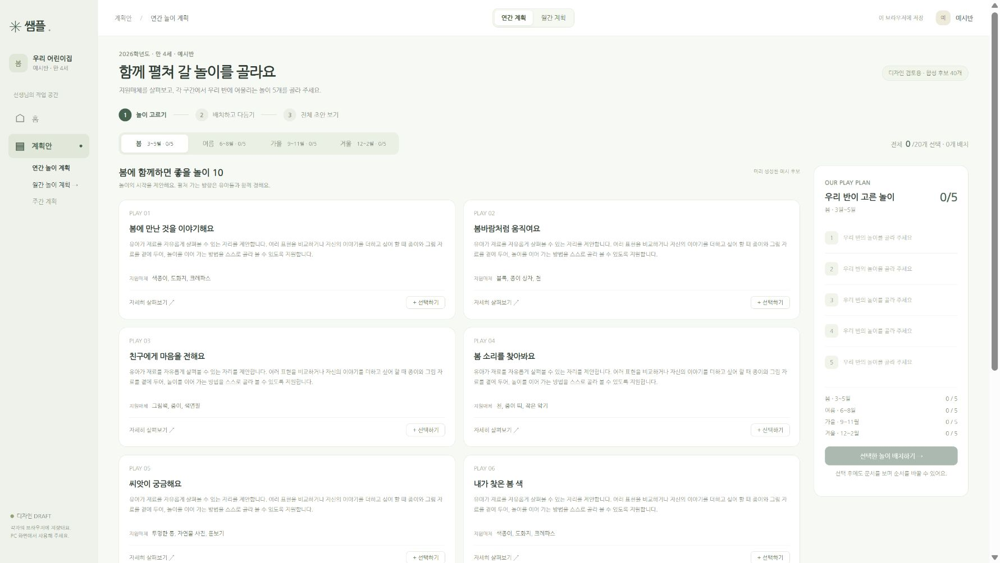
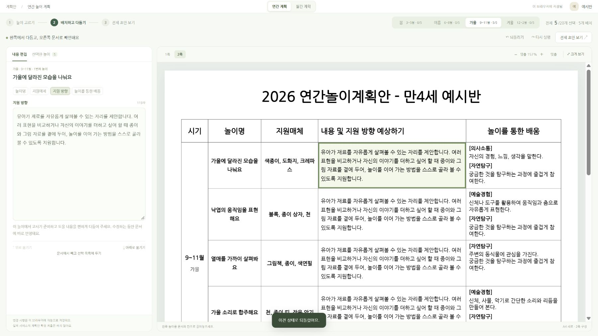
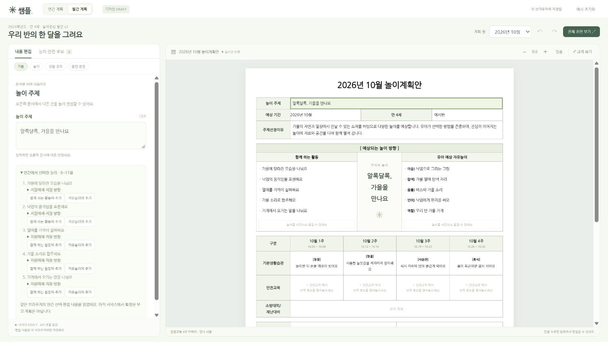
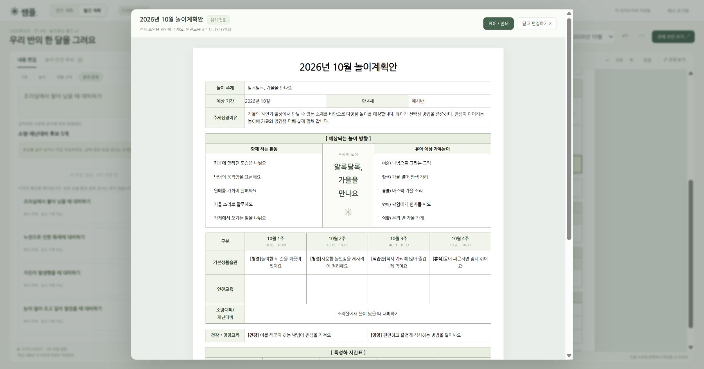

# 쌤플 연간·월간 UI — 디자인 검토용 DRAFT

> **프론트 팀의 화면·동작 검토 자료입니다. 운영 코드나 새 API 계약이 아닙니다.**
> `frontend/`, `backend/`, `p0-planning/`은 변경하지 않습니다. 병합해도 서비스 화면에 적용되지 않습니다.

## 바로 보기

저장소 루트에서 Node 24로 실행합니다. 패키지 설치·DB·로그인·키 파일이 필요 없습니다.

```sh
node docs/ui-drafts/play-plans/serve.cjs
```

- 연간: <http://127.0.0.1:8886/yearly/>
- 월간: <http://127.0.0.1:8886/monthly/?month=10>
- 다른 포트: `node docs/ui-drafts/play-plans/serve.cjs 8887`
- 종료: 터미널에서 Ctrl+C. 파일을 직접 더블클릭하는 대신 위 서버로 엽니다.
- 서버는 이 폴더의 정해진 정적 자산만 제공합니다. 외부 네트워크·유료 모델·팀 API 호출은 없습니다.

PC 약 1440×900 화면을 기준으로 검토합니다. 상단 연간/월간 링크로 이동할 수 있습니다.

## 화면 캡처

합성 예시로 실제 Chrome에서 촬영했습니다. 캡처의 문장은 교육 내용·모델 품질 검토 대상이 아닙니다.

| 연간 후보 선택 | 연간 문서 편집 |
|---|---|
|  |  |

| 월간 편집과 연간 참고 | 월간 읽기 전용 미리보기 |
|---|---|
|  |  |

## 검토 순서

1. **연간 놀이 고르기:** 계절마다 후보 10개를 보고 5개를 선택합니다.
2. **배치하고 다듬기:** 왼쪽에서 선택한 놀이를 오른쪽 문서 칸에 끌어놓습니다. 위/아래 버튼도 있습니다.
3. **칸 편집:** 오른쪽 문서 칸을 누르면 왼쪽 편집기가 열리고 즉시 반영됩니다. 연간의 배움은 읽기 전용입니다.
4. **확대와 전체 초안:** 문서만 확대해서 보거나 전체 초안을 확인합니다. 연간은 봄·여름 / 가을·겨울의 A4 세로 2쪽 구성을 참고합니다.
5. **월간 연결 보기:** 연간에서 가을 놀이 5개를 고른 뒤 월간 10월로 이동하면 같은 브라우저의 선택·편집값을 참고 목록에서 볼 수 있습니다. 9·10·11월은 같은 계절 놀이를 공유합니다.
6. **월간 후보 배치:** 안전교육 후보를 주차에 넣고, 같은 후보를 다른 주에도 써 봅니다. 훈련 후보는 별도 칸에 골라 넣거나 직접 적습니다.

각 패널은 독립적으로 스크롤합니다. 문서 확대 화면은 읽기 전용이며 편집 화면과 같은 현재 값을 보여 줍니다.

## 범위와 최신 결정

| 구분 | 이 시제품 | 실제 제품 연결 시 지킬 것 |
|---|---|---|
| 연간 후보 | 4구간 × 합성 예시 10개 | 생성 Core의 후보와 안정적인 ID를 사용 |
| 연간 선택 | 브라우저에서 구간별 0~5개 선택·순서 조정 | 선택 저장 API와 `CANDIDATES_SELECTED` 이력 연결. 확정은 구간별 정확히 5개 |
| 연간 편집 | 선택한 놀이명·재료·지원 방향 편집, 배움 읽기 전용 | Core 편집/확정 정책 유지. 확정은 제출·발송이 아님 |
| 월간 놀이 | 함께 하는 활동 5개·자유놀이 5개로 시작 | 행 추가·삭제·이력·확정은 Core 연결. 놀이 설명은 편집 화면에만 표시 |
| 월간 순서·구역 이동 | 드래그 동작을 검토하는 디자인 제안 | 현재 Core L3에는 순서 변경·구역 이동 명령이 없음. 계약·구현 전 제품 동작으로 보장하지 않음 |
| 안전교육 | 8개 예시 후보와 빈 주차, 후보 재사용 | 후보 수는 법정 횟수·시수가 아님. 문장이 빈 배치의 안내 등 Core 상태와 연결 |
| 훈련 | 별도 5개 예시, 직접 작성·후보 가져오기 | 직접 작성 MANUAL / 후보 복사 RULE_ONLY + 원래 ID·값 / 이후 교사 수정은 방식 유지 |
| 생활·건강·영양 | 예시 문장 선택·편집 | 승인 문장 교체는 Core 후속 범위. 시제품 선택 목록을 승인 Catalog로 간주하지 않음 |
| 연간→월간 | 같은 브라우저의 참고 목록 | 실제 월간 v2는 **CONFIRMED 연간 v2**가 필수 부모. 계절의 선택 놀이 5개를 세 달이 공유하며 소진하지 않음 |
| 저장 | 별도 디자인 전용 localStorage 키 | 이 저장 방식을 제품 계약으로 채택한 것이 아님. 팀 API·감사 이력·개정 충돌 처리로 대체 |
| 문서 | 브라우저 표·인쇄 미리보기 | HWPX 연결은 없음. 브라우저 쪽 나눔을 HWPX의 정답으로 사용하지 않음 |

기존 연간 v1→월간 v1→주간 v1은 이 시제품으로 바뀌지 않습니다. 월간 v2→주간 연결은 정하지 않았습니다.
계약 근거는 [ADR-042](../../adr/042-yearly-v2-common-and-format-contracts.md), 팀 API 명세와 후속 월간 v2 계약을 확인합니다.
이 README는 ADR이나 API 계약을 수정하지 않습니다.

## 프론트 구현으로 옮길 때

- 기존 Next.js 화면·공용 컴포넌트에 디자인을 옮깁니다. 이 IIFE·전역 객체·모델을 그대로 운영 코드에 복사하지 않습니다.
- 독립 스크롤, 선택 수 표시, 클릭 편집, 확대의 읽기 전용 표시, 빈 상태, 되돌리기 등 상호작용을 우선 검토합니다.
- 키보드로 누를 수 있는 버튼과 드래그 대체 버튼을 유지합니다. 색상만으로 선택 상태를 구분하지 않습니다.
- 생성·저장 연결에서는 loading/empty/success/error, 실패 시 기존 값 보존, 저장 충돌, 확정 후 읽기 전용을 실제 계약대로 구현해야 합니다. 이 자료에는 가짜 성공 API도 없습니다.
- 나눔고딕은 로컬에서 같은 모양을 보기 위한 단일 TTF와 OFL 라이선스를 함께 둡니다. 운영 웹에는 프론트의 WOFF2/dynamic subset 규칙을 적용하며, 글꼴 선택 기능을 추가한 것은 아닙니다.

## 데이터·개인정보

- 연간 40개와 월간 내용은 **화면 확인용 합성 fixture**입니다. 실제 LLM 출력·원본 Reference 문서·개인 실측 결과 파일은 포함하지 않습니다.
- `curriculum.js`는 읽기 전용 표시 자료입니다. 현재 문장과 ID의 의미 연결이 승인됐거나 런타임 Reference가 활성화됐다는 뜻이 아닙니다.
- 운영 정보·생일·가정연계는 빈칸으로 시작합니다. 실제 교사·아동 정보를 입력하지 마세요.
- 입력은 이 디자인의 브라우저에만 남습니다. 같은 PC를 공유할 때는 별도 브라우저 프로필을 사용하거나 해당 사이트 데이터를 지웁니다. 기존 서비스/로컬 실측 화면과 저장 키를 분리했습니다.
- `.env`, 공급자 주소·키, 비용 ledger, 실제 생성 결과 불러오기, 유료 생성 서버는 전달 대상에서 제외했습니다.

## 파일 안내

- `yearly/`: 연간 후보 선택·문서 배치 화면과 합성 후보
- `index.html`, `app.js`, `styles.css`, `model.js`, `data.js`: 월간 화면과 동작 예시
- `yearly-bridge.js`: 브라우저 시제품 안의 연간 참고 목록 연결
- `plans-nav.css`: 두 화면의 전환 링크
- `screenshots/`: 화면 검토용 캡처
- `serve.cjs`: localhost 전용 정적 미리보기 서버
- `*.test.cjs`: UI 동작 모델과 미리보기 전달 검사

## 검증

이 폴더에서:

```sh
node --test model.test.cjs yearly-bridge.test.cjs preview.test.cjs
node --check app.js
node --check yearly/app.js
```

직접 실행: Node 동작 검사 **20 passed**, 두 app.js 구문 검사 통과.
Chrome 1800×945에서 연간 5개 선택→배치, 재료 편집의 문서 반영→되돌리기, 배움 읽기 전용(선택 checkbox 없음),
월간 참고 목록 연결, 훈련 후보 가져오기→읽기 전용 미리보기→되돌리기를 확인했습니다. 월간 전체 페이지의 가로·세로 넘침은 없었습니다.

NOT_VERIFIED: 실제 마우스 드래그, 다른 브라우저·모바일, 인쇄/PDF 결과·HWPX 쪽 수.
NOT_RUN: 제품 API·DB·실제 LLM. 위 검사를 이들의 통과 결과로 표시하지 않습니다.
